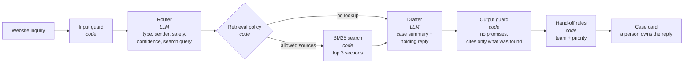

# Inquiry Triage Agent

An AI agent that sorts website inquiries for a small equipment distributor. It decides what each message is, looks up the right manual or policy, drafts a case summary, and hands the case to the right team. **A person always owns the reply.** The agent never promises a refund, a replacement, a price, or partner terms. Code enforces this rule.

**Demo:** [inquiry-triage-agent.streamlit.app](https://inquiry-triage-agent.streamlit.app) (no sign-in). · **Data:** 100% synthetic. · **Company:** Fernhollow Equipment Supply is invented.

This is a public twin of an inquiry-triage tool that I am designing for a small distributor. That tool is still in progress. This repo uses no data from that business.

## The problem

A small distributor gets three kinds of website messages, mixed in one inbox:

- **Machine trouble** from customers and dealers ("my chipper keeps jamming").
- **Quality complaints** ("the splitter arrived with a bent frame", "3 units in one shipment have cracked wedges").
- **Partner requests** from businesses that want to sell the line.

Some messages are also spam, invoices, job applications, or questions about order status. Some arrive in Spanish. A few hide a safety problem in the middle of a long message.

By hand, one person reads each message, sorts it, finds the right document, writes a summary, picks a team, and forwards it. That is [10 steps](docs/manual-process.md). With the agent, the person does 3 steps: read the case card, check it, and edit and send the reply. This is a step count, not a time measurement.

## How it works



The LLM makes 2 decisions: what the message is, and what the summary says. Code makes every decision that has a business rule behind it ([ADR 0002](docs/decisions/0002-code-owns-business-rules.md)):

| Type | Customer (DTC) | Business (B2B) | Documents it may search |
|---|---|---|---|
| Machine trouble | Service desk | Service desk, high | manuals, troubleshooting, warranty |
| Quality complaint | Customer care | Quality team, high | returns, defect, freight, parts, safety, warranty |
| Partner request | Partner team | Partner team | partner program |
| Unclear / other | Front desk, low | Front desk, low | shipping, contact, parts ordering |

A safety issue (smoke, fuel leak, thrown parts, injury) is always **urgent** and is copied to the Quality team. A router confidence below 0.4 sends the case to the Front desk with no lookup.

Stack: Python 3.12, LangGraph, the Anthropic SDK with structured outputs (Claude Haiku 5.5), Pydantic, `rank-bm25`, Streamlit, pytest, and uv.

## Results

The eval set has **560 synthetic inquiries: 280 from customers (DTC) and 280 from businesses (B2B)**, split 281 dev / 279 test. About 30% carry a hard-case tag: typos, very short, long and rambling, angry, prompt injection, mixed requests, Spanish, no model number, or a hidden safety issue. See [how the data was made](#the-data).

Test split, 279 rows:

| Metric | No-LLM baseline | LLM agent (Haiku 5.5) |
|---|---:|---:|
| Type accuracy | 74.9% | not run yet |
| Sender (DTC/B2B) accuracy | 90.7% | not run yet |
| Hand-off accuracy (team and priority) | 70.3% | not run yet |
| Retrieval hit rate (an expected doc in the top 3) | 70.2% | not run yet |
| Retrieval hit rate when the type is right | 94.0% | not run yet |
| Correctly skipped lookups | 61.8% | not run yet |
| Safety recall (safety rows marked urgent) | 71.4% | not run yet |
| Drafts that reached a person with a promise | 0 | not run yet |
| Cost per inquiry | $0 | not run yet |

The baseline is a keyword router with a template drafter. It is the bar the LLM agent must beat. Its weak spots show where an LLM should help: Spanish messages (27% type accuracy), hidden safety issues (25%), and "firewood" read as a fire. Full reports: [test](eval/results/2026-11-07_offline_test.md), [dev](eval/results/2026-11-07_offline_dev.md).

The LLM column needs one run with an API key. My estimate for one test run is about $0.30. Run it like this:

```bash
uv run python eval/run_eval.py --mode llm --split test --runs 3
```

## The data

All data is synthetic ([ADR 0005](docs/decisions/0005-label-first-synthetic-data.md)):

1. **Labels first.** A scenario catalog in [`scripts/make_specs.py`](scripts/make_specs.py) fixes the type, the sender, the safety flag, and the expected documents. A seeded script draws 560 specs.
2. **Text second.** Claude subagents wrote one message per spec. They saw the situation, not the label names.
3. **Checks.** [`scripts/build_golden.py`](scripts/build_golden.py) rejects label words in the text, emails outside example.com, and unknown document IDs. It also warns about near-duplicates and real brand names. Half of the business senders leave the company field empty, so the router must read the sender type from the text.
4. **Blind second label.** A separate agent labeled 80 random rows from [the labeling guide](data/eval/LABELING.md) alone. It agreed on type for 95% of rows, and on sender and safety for 100%. I reviewed the 4 disagreements and fixed 3 labels, with reasons in [`label_fixes.json`](scripts/label_fixes.json). See [the agreement report](data/eval/label_agreement.md).
5. **Documents.** 27 invented manuals, troubleshooting guides, and policies in [`data/docs/`](data/docs/).

## Run it

```bash
git clone https://github.com/jamieYe0317/inquiry-triage-agent.git && cd inquiry-triage-agent
uv sync
uv run pytest -q                                              # 76 offline tests, no key
uv run python eval/run_eval.py --mode offline --split test    # baseline eval, no key
uv run streamlit run streamlit_app.py                         # demo on localhost:8501
```

For the LLM agent, set `ANTHROPIC_API_KEY` (see `.env.example`). Without a key, the demo's "Write your own" tab runs the free baseline and says so.

## Demo and cost limits

The [demo](https://inquiry-triage-agent.streamlit.app) runs on Streamlit Community Cloud with no sign-in. The sample buttons show saved runs and cost nothing ([ADR 0004](docs/decisions/0004-replays-for-samples.md)). The "Write your own" tab calls the LLM, with these limits:

- 10 live runs per visitor and 100 per day. After that, the tab runs the free baseline.
- A 2,000-character input cap and a fixed `max_tokens` on each call.
- A hard monthly spend limit of $5 in the Anthropic console.

Free Streamlit apps sleep when nobody visits. The first visitor may wait for the app to wake up.

## Honest limits

- **Synthetic data from one model family.** Claude wrote the inquiries, and Claude routes them. Real messages are messier, and the numbers here may be higher than on real traffic.
- **Labels from the builder.** I wrote the scenarios and the labeling guide. A second agent checked a sample. No human annotator labeled the set from scratch.
- **"Main request" is a judgment call.** Some messages hold two or three requests. The guide picks the one with the most words.
- **The promise guard uses regular expressions.** It catches the phrasings in [`tests/test_guards.py`](tests/test_guards.py). It can miss new phrasings.
- **BM25 matches words, not meaning.** It works on this small corpus. A larger corpus may need embeddings.
- **No time measurement yet.** The before-and-after is a step count.
- **Not connected to anything.** The agent writes no email, no CRM record, and no message to a customer.

## Repo map

| Path | What it is |
|---|---|
| `src/triage/graph.py` | The LangGraph graph |
| `src/triage/router.py`, `drafter.py` | LLM and baseline versions of the 2 LLM steps |
| `src/triage/guards.py`, `handoff.py`, `policy.py` | The code-owned rules |
| `src/triage/retrieval.py` | BM25 over `data/docs/` |
| `eval/run_eval.py` | The eval. Writes `eval/results/*.md` and `*.json` |
| `data/eval/golden.jsonl` | 560 labeled inquiries |
| `docs/decisions/` | Decision records |
| `PLAN.md` | The build plan |

MIT license.
